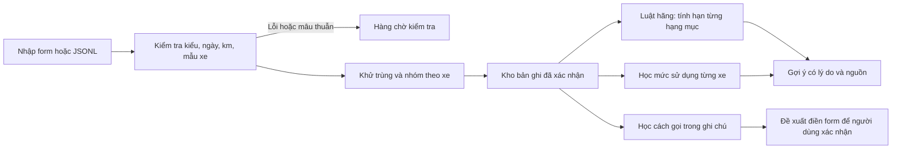

# Thuật toán và cách áp dụng cho MotoMaintain

Cập nhật 12/10/2026. Đây là phương án cho dữ liệu bảo dưỡng xe máy; chưa có tập dữ liệu thực tế có nhãn hỏng hóc để chứng minh mô hình nào dự báo tốt nhất. Phân biệt ba loại dữ liệu: **lịch hãng** là tri thức tham chiếu, **lịch sử người dùng** là quan sát sử dụng, **nhãn hư hỏng được xác nhận** mới là dữ liệu để học rủi ro hỏng.

## 1. Các thuật toán thường gặp theo môn

Các môn có phần giao nhau. Ví dụ Transformer thuộc học sâu và được dùng trong NLP; Spark là hệ thống xử lý phân tán, không phải một mô hình dự đoán.

| Môn         | Thuật toán / phương pháp tiêu biểu                                                                                                                        | Bài toán                                                                                  |
| ----------- | --------------------------------------------------------------------------------------------------------------------------------------------------------- | ----------------------------------------------------------------------------------------- |
| Học máy     | Linear/Ridge/Lasso Regression; Logistic Regression; k-NN; Naive Bayes; Decision Tree; Random Forest; Gradient Boosting (XGBoost, LightGBM, CatBoost); SVM | Hồi quy, phân loại dữ liệu dạng bảng/văn bản                                              |
| Học máy     | k-means, DBSCAN, Gaussian Mixture; PCA; Isolation Forest, LOF; hồi quy bền vững Theil–Sen/Huber; survival analysis (Cox, survival forest)                 | Phân nhóm, giảm chiều, dữ liệu bất thường, dự báo tốc độ sử dụng và thời gian đến sự kiện |
| NLP         | Chuẩn hóa Unicode, tách từ; regex/từ điển; Bag-of-Words, TF-IDF; Naive Bayes, Linear SVM; BM25; HMM/CRF cho nhãn chuỗi                                    | Làm sạch ghi chú, nhận dạng hạng mục, tìm tài liệu                                        |
| NLP         | Embedding, tìm kiếm vector; BERT/PhoBERT; Transformer; RAG kết hợp truy xuất và sinh câu trả lời                                                          | Hiểu cách diễn đạt khác nhau, trích thực thể, trả lời có nguồn                            |
| Dữ liệu lớn | Hash partitioning, external sort/merge, MapReduce, incremental aggregation, reservoir sampling, Bloom filter, Count-Min Sketch, HyperLogLog               | Chia dữ liệu, tổng hợp theo lô/luồng, lấy mẫu và thống kê xấp xỉ                          |
| Dữ liệu lớn | Spark SQL/Structured Streaming, Flink; checkpoint, watermark, deduplication, backpressure                                                                 | Công cụ/kỹ thuật triển khai pipeline phân tán, giới hạn dữ liệu chờ xử lý                 |
| Học sâu     | MLP; CNN; RNN/LSTM/GRU; Autoencoder; Transformer; GNN                                                                                                     | Dữ liệu bảng, ảnh phụ tùng, chuỗi cảm biến, phát hiện bất thường, ngôn ngữ và quan hệ     |

Nguồn nền tảng: [scikit-learn – danh mục mô hình và phát hiện bất thường](https://scikit-learn.org/stable/modules/outlier_detection.html), [Naive Bayes](https://scikit-learn.org/stable/modules/naive_bayes.html), [PhoBERT](https://arxiv.org/abs/2003.00744), [Spark Structured Streaming](https://spark.apache.org/docs/latest/streaming/index.html).

## 2. So sánh để chọn cho dự án này

Đánh giá chi phí dưới đây mang tính tương đối, chưa phải kết quả benchmark các mô hình trên cùng tập dữ liệu của dự án.

| Phương pháp                             | Dữ liệu cần                                                       | Ưu điểm                                                                             | Hạn chế                                                                 | Quyết định                                                 |
| --------------------------------------- | ----------------------------------------------------------------- | ----------------------------------------------------------------------------------- | ----------------------------------------------------------------------- | ---------------------------------------------------------- |
| Luật từ tài liệu hãng + chỉ mục lịch sử | Mẫu/mã xe, hạng mục, ngày, km và nguồn                            | Giải thích được từng mốc; dùng ngay khi ít dữ liệu                                  | Không học rủi ro hỏng thực tế                                           | **Đã dùng làm nền tảng**                                   |
| Theil–Sen                               | Nhiều quan sát ngày–km của cùng xe                                | Ước tính km/ngày, ít bị một quan sát lệch kéo sai hơn hồi quy bình phương tối thiểu | Không suy ra tình trạng phụ tùng; cần lịch sử đủ dài                    | **Đã dùng cho dự báo ngày đạt mốc km**                     |
| Từ điển/regex + Multinomial Naive Bayes | Ghi chú đã được người dùng xác nhận và hạng mục tương ứng         | Nhẹ, chạy cục bộ, học được cách gọi riêng                                           | Ngữ cảnh/phủ định phức tạp vẫn có thể sai                               | **Đã dùng hỗ trợ điền form**, luôn yêu cầu bấm áp dụng     |
| TF-IDF + Logistic Regression/Linear SVM | Tập ghi chú có nhãn đủ đa dạng                                    | Baseline đáng so sánh với NB; dễ đánh giá theo lớp                                  | Cần huấn luyện/đánh giá, khó hiểu ngữ cảnh sâu                          | Giai đoạn sau, so sánh trên dữ liệu thật                   |
| CatBoost/LightGBM/Random Forest         | Dữ liệu bảng có nhãn: tuổi xe, cách dùng, thời điểm hỏng/kiểm tra | Phù hợp quan hệ phi tuyến và nhiều đặc trưng                                        | Nếu chỉ có ngày thay dầu sẽ học thói quen thay, không phải lúc dầu hỏng | Chưa huấn luyện; chờ nhãn thực tế                          |
| Isolation Forest                        | Nhiều bản ghi tương đối nhất quán                                 | Xếp hàng các giá trị khác thường để kiểm tra                                        | Bất thường không có nghĩa là sai/hỏng                                   | Dùng sau bộ kiểm tra cứng; chưa triển khai                 |
| BM25 + embedding + RAG                  | Tài liệu có quyền sử dụng, đã phân đoạn đúng mẫu/đời xe           | Tra cứu và giải thích kèm nguồn                                                     | Truy xuất sai đời xe vẫn có thể tạo trả lời sai                         | Giai đoạn sau; hiện có thư viện nguồn, chưa có chatbot RAG |
| PhoBERT                                 | Ghi chú tiếng Việt gán nhãn và ngân sách suy luận                 | Có thể hiểu ngữ cảnh tốt hơn từ khóa                                                | Cần benchmark, xử lý câu phủ định và cách nói nghề; nặng hơn NB         | Chỉ nâng cấp khi baseline không đạt yêu cầu                |
| LSTM/GRU/Transformer chuỗi              | Chuỗi quan sát đủ dày, tốt nhất có cảm biến và sự kiện hỏng       | Học diễn biến theo thời gian                                                        | Lịch sử bảo dưỡng thưa không đủ để có kết luận đáng tin                 | Chưa phù hợp dữ liệu hiện tại                              |
| CNN/ViT                                 | Ảnh phụ tùng với nhãn được thợ xác nhận                           | Hỗ trợ phân loại ảnh/tình trạng                                                     | Cần dữ liệu ảnh và đánh giá riêng                                       | Chưa cần cho phiên bản này                                 |
| Spark/Flink                             | Khối lượng/throughput vượt một máy, nhiều nguồn liên tục          | Phân tán công việc, xử lý luồng                                                     | Tăng chi phí triển khai/vận hành; không tự sửa dữ liệu khó hiểu         | Chưa đưa vào app; thiết kế đường nâng cấp                  |

Tham khảo phương pháp: [Theil–Sen](https://scikit-learn.org/stable/modules/linear_model.html#theil-sen-regression), [tree ensembles](https://scikit-learn.org/stable/modules/ensemble.html#histogram-based-gradient-boosting), [RAG – bài báo gốc](https://arxiv.org/abs/2005.11401). Các lựa chọn cho MotoMaintain ở bảng trên là đề xuất kỹ thuật của dự án, không phải kết luận do các nguồn này đánh giá riêng cho xe máy Việt Nam.

## 3. Phần đã chạy trong app/web

### Tính mốc từ tài liệu

- Dữ liệu hãng được thêm dưới **mẫu xe có mã tài liệu riêng**, không tự đổi các mẫu minh họa cũ thành dữ liệu đã xác minh.
- Hỗ trợ mốc km tích lũy, mốc chạy rà đầu tiên, mốc chỉ theo tháng hoặc chỉ theo km. Ví dụ dầu động cơ trong các tài liệu đã đọc có mốc 1.000 rồi 6.000 km; thay ở 1.000 không dẫn đến phép cộng sai thành 7.000.
- Hạng mục theo công-tơ-mét bám các mốc danh định của tài liệu. Lần làm sớm không tự xóa mốc hãng kế tiếp; thợ có thể cần điều chỉnh lịch theo thực tế.
- Phân biệt **kiểm tra phanh** với **thay dầu phanh**, **kiểm tra lọc gió** với **thay lọc gió**. Không dùng một việc để đặt lại mốc việc khác.
- Không biết lần thực hiện trước thì hiển thị “Chưa đủ dữ liệu”, không coi ngày mua xe cũ là ngày thay tất cả phụ tùng.
- Nhắc nhở hiện nằm trong app/web khi mở ứng dụng; chưa có push chạy nền.

### Học mức sử dụng từng xe

`shared/learning.ts` lấy tối đa 60 ngày quan sát gần nhất; cần ít nhất 3 ngày khác nhau, trải dài ít nhất 30 ngày và quan sát cuối không quá 90 ngày. Tính trung vị độ dốc giữa các cặp cách nhau ít nhất 7 ngày. Tối đa 1.770 cặp cho mỗi xe.

Hệ thống không dự báo khi km giảm theo ngày, tốc độ ngoài khoảng kiểm soát hoặc độ phân tán lớn. Những ngưỡng này là quy tắc kỹ thuật ban đầu, chưa được tối ưu trên dữ liệu thực tế. Số km hiện tại không có ngày đo nên không được giả làm quan sát “hôm nay”. Ngày dự báo dựa vào lần ghi nhận có ngày rõ ràng; luôn hiện tách khỏi hạn bảo dưỡng.

### Học cách gọi hạng mục trong ghi chú

Mô hình NB được tính lại từ tối đa 2.000 ghi chú gần nhất, **cùng tài khoản và mẫu xe**. Chỉ bản ghi đã lưu có đúng một hạng mục mới được làm ví dụ có nhãn; bản ghi đang sửa bị loại khỏi tập học. Xóa/sửa ghi chú sẽ thay đổi tập học trong lần tính tiếp theo.

Khi chưa đủ ít nhất 10 ví dụ và 3 ví dụ mỗi lớp, phần học chưa đưa dự đoán; từ điển vẫn nhận được một số cách gọi phổ biến. Từ vựng giới hạn 4.096 từ. Điểm NB là điểm nội bộ, **không phải “độ chính xác 80%”**. Gặp câu chưa hiểu hoặc có từ phủ định/dự định, hệ thống yêu cầu chọn thủ công. Ghi chú không tự lưu, không tự thay mốc hãng và không gửi sang dịch vụ AI bên ngoài.

## 4. Dữ liệu lớn: chia việc và không trộn dữ liệu

Đã có:

- Bộ tính gom lịch sử và hạng mục bằng `Map`, tránh quét/sắp xếp toàn bộ lịch sử cho mỗi cặp xe–hạng mục. Phần xây chỉ mục gần O(R × số hạng mục mỗi bản ghi + I); học mức sử dụng còn bước sắp xếp ngày của từng xe, nên không tuyên bố toàn bộ thuật toán O(R).
- Truy vấn dữ liệu cá nhân lọc `user_id` ngay tại Supabase, đi theo con trỏ `id`, mỗi lượt 500 dòng; có index `(user_id,id)` và RLS.
- Màn hình gợi ý mặc định một xe, hiển thị 12 hạng mục mỗi lượt, mở chi tiết khi cần.
- Công cụ `tools/prepare-data.mjs` đọc JSONL theo luồng, giới hạn dòng 64 KiB; dùng SQLite trên đĩa cho khử trùng và kiểm tra lịch sử qua nhiều lô; commit mỗi 1.000 bản ghi; ghi đầu ra có backpressure.
- Bản ghi lỗi không vào tập học. Khi một mã xe có mẫu xe mâu thuẫn hoặc km đi lùi, cả nhóm được tách để kiểm tra. Có hash SHA-256 nguồn, số dòng, báo cáo và artifact mô hình riêng cho từng mẫu xe.
- Tách học/kiểm tra theo ngày cắt do người chạy chọn; loại văn bản kiểm tra trùng văn bản huấn luyện. Báo cả coverage, số lần từ chối, số đúng và thống kê theo lớp.

**Giới hạn hiện tại:** app vẫn gom toàn bộ lịch sử của tài khoản vào bộ nhớ sau các trang tải; danh mục chung cũng tải đầy đủ. Đây chưa phải kiến trúc giao diện cho một tài khoản có hàng triệu bản ghi. Trước quy mô đó cần chuyển thống kê/mốc gần nhất sang SQL/materialized view, API lịch sử phân trang theo yêu cầu, danh mục tìm kiếm phía server, hàng đợi worker và quota. Bộ nhập offline đã tách khỏi luồng tương tác để việc chuẩn bị tập học lớn không chạy trong trình duyệt. Chưa có cluster Spark/Flink, tự triển khai model hay tự học xuyên tài khoản.

## 5. Cách đánh giá trước khi nâng cấp mô hình

- Dự báo km/ngày: backtest theo thời gian, báo MAE/median absolute error ngày đạt mốc; so với tốc độ trung bình đơn giản. Không dùng dữ liệu tương lai để tạo đặc trưng.
- Nhận dạng ghi chú: precision/recall/F1 theo từng hạng mục, macro-F1 và coverage; kiểm thử riêng câu phủ định, nhiều công việc, viết tắt, sai chính tả và mẫu xe lạ. Đánh giá trên văn bản chưa thấy; không báo điểm trên tập học là độ chính xác thật.
- Dự báo hỏng: cần nhãn kiểm tra/hỏng thực tế và những xe chưa hỏng (censored observations). Không dùng lịch người dùng tự thay làm nhãn “phụ tùng đã hỏng”.
- Tách đánh giá người dùng mới theo người/xe, ngoài đánh giá theo thời gian trên xe đã biết. Pipeline hiện có temporal split; group holdout cần bổ sung khi đánh giá mô hình dùng chung.
- Chạy mô hình mới ở chế độ đối chiếu, lưu phiên bản và so sánh baseline trước khi kích hoạt. Bất kỳ model học nào cũng không tự kéo dài hạn hãng chỉ vì người dùng thường bảo dưỡng muộn.

## 6. Nguồn dữ liệu đã đưa vào dự án

| Tài liệu chính hãng                                                                                                  | Phạm vi đã đối chiếu                           | Áp dụng             |
| -------------------------------------------------------------------------------------------------------------------- | ---------------------------------------------- | ------------------- |
| [Honda Air Blade 2025](https://2rom-prd-data.hondamotopub.com/om/HVN/Air%20Blade%20125/2025/AB_2025.pdf)             | Bảng trang 71–72, ACA125CBF/ACA160CAF Việt Nam | Hai mẫu, 14 quy tắc |
| [Honda Wave Alpha 2025](https://2rom-prd-data.hondamotopub.com/om/HVN/Wave%20Alpha/2025/Wave%20Alpha_4FK89A30_0.pdf) | Bảng trang 39–40, tài liệu 4FK89A30            | Một mẫu, 4 quy tắc  |
| [Honda SH – tài liệu 11/2025](https://cdn.honda.com.vn/motorbike-manual/November2025/UG9NBoEDyF0DHrjoTphA.pdf)       | Bảng trang 117–118, SH125D/AD và SH160D/AD     | Hai mẫu, 14 quy tắc |

Chỉ lưu các sự kiện lịch bảo dưỡng cần thiết cùng liên kết/trang nguồn; không phân phối lại toàn bộ sách. Đây là **32 quy tắc tham chiếu**, không phải 32 mẫu hỏng hóc để huấn luyện. Giá chưa có nguồn được để “Chưa có báo giá”. Các mốc đặc biệt trong điều kiện bụi, ẩm, tải nặng cần đối chiếu sách/thợ; chưa có hệ số tự động cho mọi điều kiện.

Các mã nguồn chính: `shared/knowledge.ts`, `shared/maintenance.ts`, `shared/learning.ts`, `tools/prepare-data.mjs`. Hướng dẫn chuẩn bị dữ liệu tiếp theo: [DATA_GUIDE.md](DATA_GUIDE.md).
